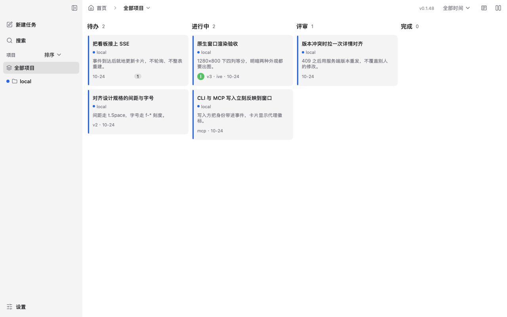
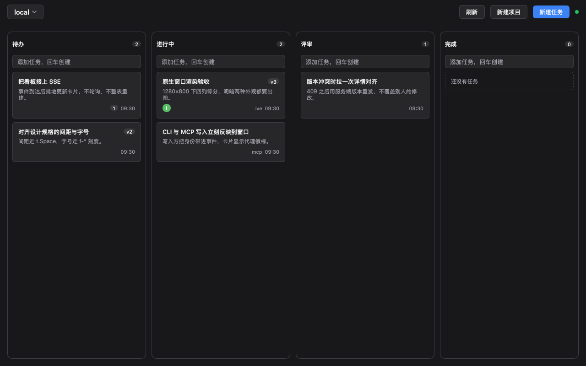
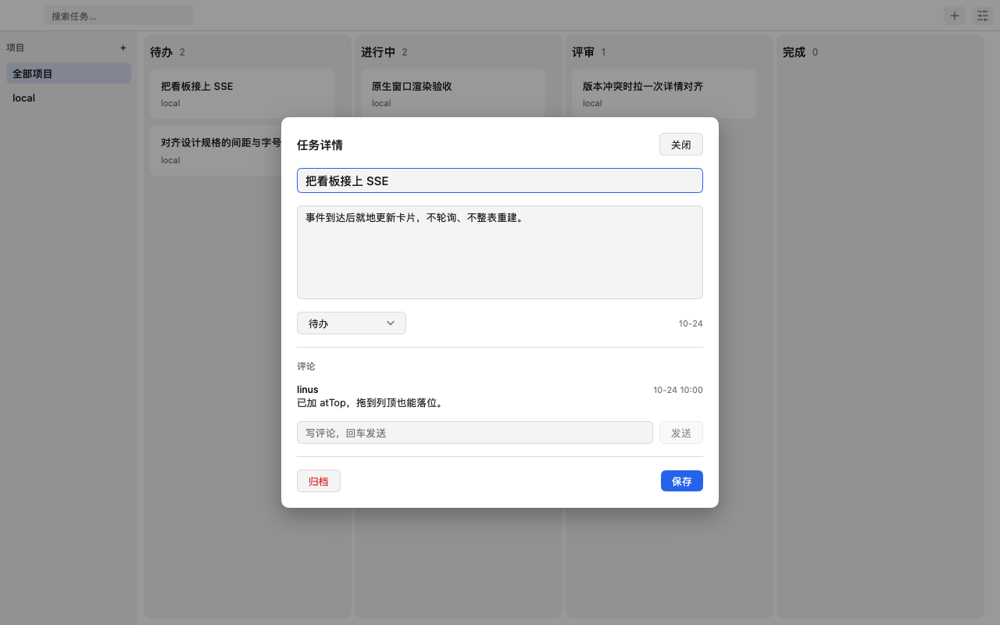
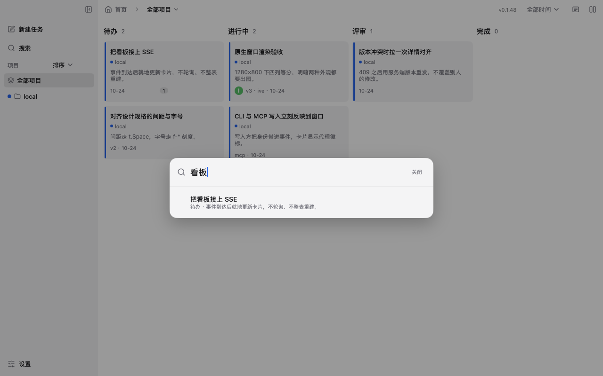
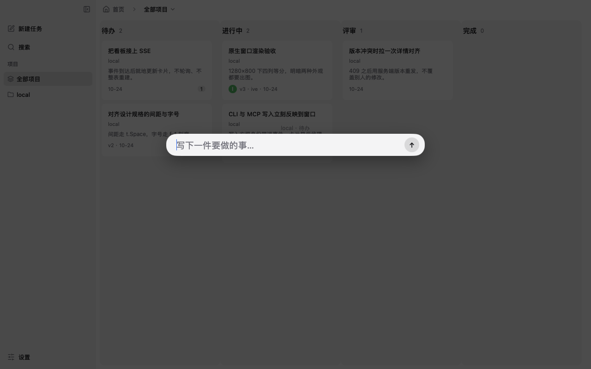

# taskboard-native

MyGo 原生看板客户端。数据层由本应用自持；DSH 插件不是运行时依赖。以本服务为唯一写者，初始用 SQLite 种子，GUI / CLI / MCP 都是它的客户端。

目标：轻量、MyGo 原生 UI（非 WebView 外壳）、CLI + MCP 供代理读写、按项目作用域查询、写入经 SSE 实时推到已打开的窗口（不轮询）。

## 界面

主界面（明色，1280×800）：



| 暗色主界面 | 任务详情 |
|---|---|
|  |  |
| **全局搜索** | **新建任务** |
|  |  |

以上为免窗口渲染图，与运行中的窗口同源同规格；更多状态（空态、加载态、长标题、窄宽度）见 `docs/assets/render/`，实拍验收截图见 `docs/assets/review/`。

## 安装（直接用，不用编译）

从 [Releases](https://github.com/ttmouse/taskboard-native/releases/latest) 下载 macOS 通用版（Apple 芯片与 Intel 通用），拖进「应用程序」即可。

应用还没有 Apple 开发者签名和公证，第一次打开前要在终端执行一次，去掉系统的隔离标记：

```bash
xattr -dr com.apple.quarantine /Applications/Taskboard.app
```

或者用安装脚本一条命令装好（下载最新版、校验 SHA-256、复制到「应用程序」、去掉隔离标记）：

```bash
curl -fsSL https://github.com/ttmouse/taskboard-native/releases/latest/download/install-macos.sh | sh
```

装了之后会自动更新：启动约 10 秒后查一次新版本，之后每天一次；有新版本会显示更新说明，可以选择安装并重启。更新包用项目自己的密钥签名，应用只接受签名匹配的更新。

发版：改 `mygo.json` 的版本号，写好 `CHANGELOG.md` 对应小节，然后

```bash
scripts/release-macos.sh
```

它会编译通用版、生成签名更新包并上传成 GitHub release，再把它设为最新版。

## 运行

```bash
# 看板窗口（内建启动本地服务，127.0.0.1:47826）
go run ./cmd/taskboard

# 代理接口
go run ./cmd/tb --agent myagent list --project local
go run ./cmd/tb --agent myagent add "新任务" --project local
go run ./cmd/tb move <taskID> 进行中
go run ./cmd/taskboard-mcp            # stdio MCP，工具见 docs/contracts.md
```

Agent 读取建议：先 `tb projects --json` 定位项目与工作路径，再用 `tb list --project ID --column 待办 --limit 20 --summary --json` 读摘要，最后 `tb show TASK_ID --json` 读正文与评论。新增项目可用 `tb project add "项目名" --path /absolute/workspace --json`；MCP 对应 `create_project`、`list_projects`、`list_tasks`、`get_task`。完整流程见 [Agent 读取入口](docs/agent-read/usage.md)。

环境变量：`TASKBOARD_ADDR`、`TASKBOARD_DB`、`TB_AGENT` / `TASKBOARD_AGENT`。`TASKBOARD_SLOW=<duration>` 仅为加载态截图用的测试钩子。

## 文档

- [docs/product-direction.md](docs/product-direction.md) · [architecture.md](docs/architecture.md) · [realtime-sync.md](docs/realtime-sync.md)
- [docs/contracts.md](docs/contracts.md)：HTTP/SSE/CLI/MCP 契约与写入边界（改接口先改这里）
- [docs/design.md](docs/design.md)：视觉与交互规格（tokens、加载态映射、明暗、无障碍）
- [docs/design-review.md](docs/design-review.md)：设计验收报告与复验记录
- [docs/review-brief.md](docs/review-brief.md)：验收环境与流程

## 校验

```bash
go build ./... && go vet ./... && go test ./...
```

免窗口渲染图（1280×800，明暗/空态/加载态）：`docs/assets/render/`；验收截图：`docs/assets/review/`。改 UI 后跑 `go test ./cmd/taskboard` 会重写这批渲染图；验收流程见 [docs/review-brief.md](docs/review-brief.md)。

## 连续 API 动效演示

**正式窗口已接入 B 柔和弹簧与 0 / 40 / 80ms 多卡抬升错峰。** API 并行执行；邻卡只平滑让位，轨道无蓝框。Playground 继续用于比较候选参数。 打开 `build/playground/darwin-arm64/Taskboard Motion Playground.app`，切换方案并播放同一场景。构建和隔离方式见 [playground/README.md](playground/README.md)。

保持 App 打开，在当前 `local` 项目中运行：

```bash
python3 scripts/demo-motion.py
```

脚本通过真实 API 连续新增三张卡片，并以重叠节奏移动到进行中、评审和完成；还包含两卡同时返回不同状态的场景。窗口仅通过 SSE 自动更新。演示会保留这三张任务，不清理既有数据。可用 `--addr` 和 `--project` 指定服务和项目。
