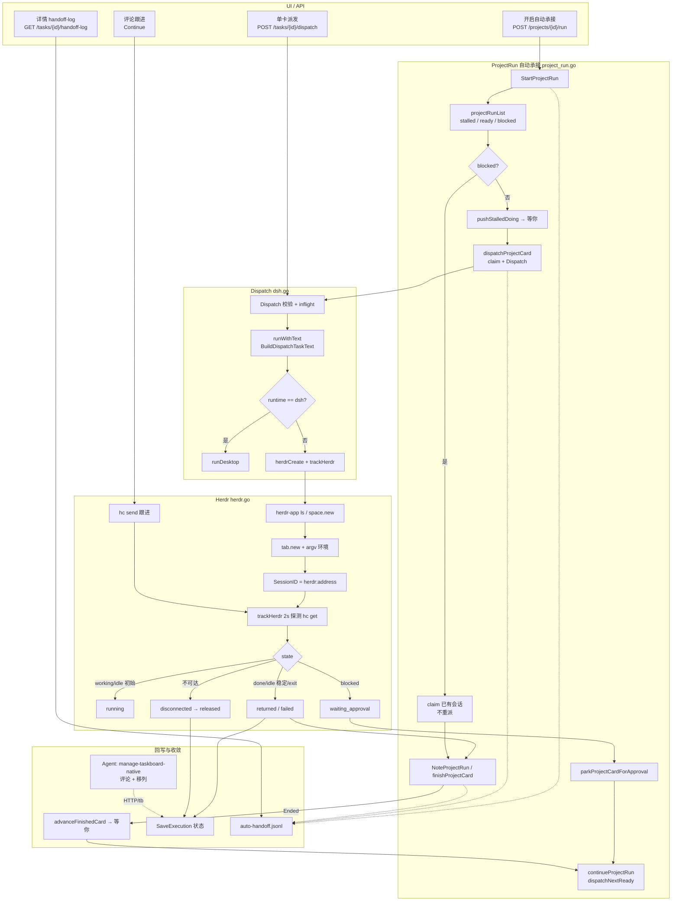
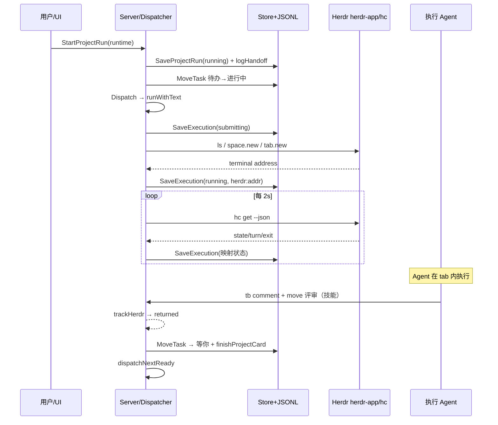

# 自动承接 + Herdr 流程分析

- 日期：2026-10-31 Asia/Shanghai
- 范围：只读分析 `taskboard-native` 源码；不改业务代码
- 主路径：开启自动承接 → 认领/派发 → Herdr 建 tab → 状态探测同步 → Agent 回写 → 收敛移列 → JSONL 日志
- 核心源码：`internal/executor/project_run.go`、`herdr.go`、`dsh.go`（Dispatch/runWithText）、`continuation.go`、`workflow.go`、`dispatch_policy.go`、`auto_handoff_log.go`、`handoff_log_read.go`；`internal/store/project_run.go`；`internal/service/server.go`；UI `cmd/taskboard/view.go` / `board.go`；技能 `docs/skills/manage-taskboard-native/SKILL.md`

---

## 1. 概述

Taskboard 的「自动承接」是**项目级开关**（`ProjectRun`），一次只跑一张卡：扫描「进行中 / 待办」→ 认领进进行中 → `Dispatch` → 非 DSH 渠道统一走 **Herdr**（`herdr-app` 建 space/tab，`hc` 探测/跟进）→ `trackHerdr` 把终端状态映射到 `Execution` → 会话收敛后 `finishProjectCard` / `advanceFinishedCard` 把卡推入「等你」并继续下一张。

**结果正文与最终业务验收不由探测循环代写**：执行 Agent 应按 `manage-taskboard-native` 用 `tb`/HTTP 写评论并移列；自动承接在会话 **Ended** 后会**代为移入「等你」**以便清空队列（与技能文案「派发程序不根据会话结束移入评审」在手动单卡派发语义上有张力，见问题表）。

持久化：

| 对象 | 存储 | 作用 |
|------|------|------|
| `ProjectRun` | SQLite `project_runs` | 开关、渠道、队列快照、游标、当前卡 |
| `Execution` | SQLite executions | 写锁与会话身份（`herdr:<address>`） |
| 自动承接日志 | `<db>.auto-handoff.jsonl` | 决策事件 JSONL（无标题/正文/路径） |
| 任务评论 / 列 | 看板主库 | Agent 回写与列角色流转 |

---

## 2. 分步说明

### 2.1 开启自动承接

1. UI：`view.projectRunControl` → `StartProjectRun(projectID, runtime)`（`POST /api/projects/{id}/run`）。
2. `StartProjectRun`（`project_run.go`）：校验 runtime / workspace → `projectRunList` 拆分 stalledDoing / ready / blocked → `SaveProjectRun(status=running)`。
3. 若有 **blocked**（仍有 Active 且非 Stalled 的会话）：只 `claimProjectCard`，**不重新派发**，记 `task.claimed_existing_execution`。
4. 否则：`pushStalledDoingCards` 把已结束/坏掉的进行中卡推入「等你」；有 ready 则 `dispatchProjectCard`。

### 2.2 认领与派发

1. `dispatchProjectCard`：推进 `Cursor`，设 `CurrentTaskID`，`claimProjectCard`（待办→进行中；已在进行中则视为已认领）。
2. 日志：`task.claimed` → `task.dispatch_started` → 调 `Dispatch`。
3. 成功：`task.dispatch_accepted`（附 `sessionId`/`executionStatus`）；`ErrInProgress` 则等待现有会话；其它错误失败并可能 `releaseProjectCard` 回退认领。
4. `Dispatch`（`dsh.go`）：inflight 互斥、依赖未阻塞、Execution Active 拒绝重派 → goroutine `run` → `runWithText(..., BuildDispatchTaskText(...))`。

### 2.3 Herdr 创建会话

`runWithText` 对 **非 DSH**：

1. 写派发评论 → `SaveExecution(submitting)` → `herdrCreate`。
2. `herdrCreate`（`herdr.go`）：按工作目录加锁 → `herdr-app ls` 匹配/创建 space → `do tab.new`，argv 注入 `TASKBOARD_ADDR`、`TB_AGENT`、`TASKBOARD_DISPATCH_TASK_ID` 与 runtime 参数（Codex/Claude 特有开关）→ 解析 terminal/address → SessionID=`herdr:`+address。
3. 不确定失败（`herdrLaunchError.uncertain`）→ Execution=`unknown`，**禁止自动重投**。
4. 成功 → `running` + `HerdrInitialTurnPendingDetail` → `syncRunningTaskColumn` → `trackHerdr`。

`BuildDispatchTaskText`：标题/正文命中代码生成标记且 runtime=Codex 时追加「Codex 实现 + Claude 评审」隐藏策略（经 `hc run`）。

### 2.4 状态同步（trackHerdr）

周期默认 2s（`herdrProbeInterval`）：

| Herdr state | Execution | 副作用 |
|-------------|-----------|--------|
| working | running | — |
| blocked | waiting_approval | `parkProjectCardForApproval` → 移「等你」+ 继续队列（Execution 仍 Active） |
| done | returned | 结束探测；任务结果靠 Agent 回写 |
| idle + Turn=0 且无 ExitCode | running（初始等待） | 不收敛 |
| idle 稳定 ≥6s（`herdrIdleGrace`） | returned | 结束 |
| ExitCode≠0 | failed | 结束 |
| 探测失败：≥3 次 | disconnected | 仍占写锁 |
| 不可达 ≥2min | released | 释放写锁 |

服务关闭：`ctx` 取消，**不收敛**，下次启动 `recoverReturnedHerdrExecutions` / `recoverProjectRuns` 续跟。

### 2.5 结果回写

两层职责：

1. **Agent（技能）**：`tb show` → 实现验证 → 评论写变更/证据 → PATCH 移评审列；跟进走 `Continue` → `sendHerdrFollowup`（`hc send`）→ 再 `trackHerdr`。
2. **自动承接服务**：`trackHerdr` 结束后 `finishProjectCard`：若 Execution `Ended` 且卡仍在进行中 → `advanceFinishedCard` 移「等你」+ 服务评论 → 清空 `CurrentTaskID` → `continueProjectRun` / `dispatchNextReady`。卡片**永不自动进「完成」**。

任务列变更经 SSE：`server` 在 task 事件上 `NoteProjectRun`，当前卡离开进行中/归档则继续下一张。

### 2.6 日志与 UI

- 写：`Dispatcher.logHandoff` → `<db>.auto-handoff.jsonl`（失败只打服务日志，不挡派发）。
- 读：`GET /api/tasks/{id}/handoff-log` → `ReadTaskHandoffEvents` + `SummarizeHandoff`。
- UI：任务详情「自动承接」区展示 summary / 事件时间线；看板顶栏开关显示「xx 承接中」。

关键事件名：`run.start_*` / `run.queue_scanned` / `run.waiting` / `run.started|stopped|failed` / `task.claimed*` / `task.dispatch_*` / `task.execution_converged|not_converged` / `task.moved_to_review` / `task.approval_*` / `run.recovery_*`。

---

## 3. 完整 Mermaid 流程图

---

## 4. 每环节问题与改进

### 4.1 开启 / 队列扫描

| 问题 | 改进建议 |
|------|----------|
| `projectRunList` 遇到任意 Active 卡即 **整队 blocked**，多卡并行/卡住的「进行中幽灵」会冻住开关 | 区分「当前 CurrentTaskID」与「其它进行中」；对非当前卡提供强制释放/人工收敛入口 |
| ready 队列在每次 `dispatchNextReady` 重扫并 `Cursor=0`，与 Start 时快照语义混用，并发建卡时顺序可能抖动 | 文档化「动态重扫」契约；或对同批次保留稳定排序键 |
| stalled 推「等你」失败则 fallback 重派，可能对已半完成卡再开会话 | fallback 前要求人类确认或仅对 `execution==nil` 重派 |

### 4.2 认领 / Dispatch

| 问题 | 改进建议 |
|------|----------|
| 认领成功但 Dispatch 失败会 `releaseProjectCard`，版本竞争时可能残留进行中 | 失败路径补手检 API；UI 提示「认领回滚失败」 |
| `Dispatch` 对 Active Herdr 一律 `ErrInProgress`，与「returned 误标但仍 working」恢复路径交织复杂 | 收敛 recovery 入口，统一「先 hc get 再决定 resume/重派」 |
| 非 DSH 的 CLI 直启代码在 `runWithText` 中位于 Herdr `return` 之后，**当前不可达** | 删除死代码或显式 feature flag，避免维护者误以为有 CLI fallback |

### 4.3 Herdr 创建

| 问题 | 改进建议 |
|------|----------|
| 多 space 同 folder/name 且多个 Active → 硬失败 | UI 展示候选 space 供选定；或按最近活跃时间打破平局 |
| `uncertain` 创建失败留下 `unknown`，需人工核对 Herdr | 详情页一键「打开 Herdr / 标记 released」 |
| Finder 启动 PATH 依赖多目录探测，仍可能漏自定义安装 | 设置项显式配置 `herdr-app`/`hc` 路径 |
| space 级 `sync.Mutex` 串行化同目录创建，高并发同项目会排队 | 可接受；文档说明即可 |

### 4.4 状态同步

| 问题 | 改进建议 |
|------|----------|
| `returned` 表示「turn 结束」，**不保证** Agent 已写评论/移列；自动承接仍可能把空结果卡推进「等你」 | 收敛前检查最近 Agent 评论或「结果回写」标记；缺失则留进行中并评论提醒 |
| idle grace 6s 可能把短暂 idle 误判结束 | 结合 Turn 递增或 Herdr 更明确的 terminal lifecycle 事件 |
| `disconnected` 仍 Active，2 分钟才 `released`；UI 若未强调写锁，用户会以为可重派 | Badge/文案区分「连接异常（锁仍在）」vs「已释放」 |
| `parkProjectCardForApproval` 移走卡后 Execution 仍 Active，跟进依赖 Continue；与「等你」人工验收列混用 | 独立「待审批」角色列或标签，避免与评审验收混淆 |
| `SaveExecution` 错误在 track 循环多处 `_ =` 忽略 | 计数/日志告警；连续失败升级 Detail |

### 4.5 结果回写

| 问题 | 改进建议 |
|------|----------|
| 技能声称「派发不因会话结束移评审」，自动承接 **会** `advanceFinishedCard` | 技能与产品文案对齐：区分「单卡手动派发」vs「项目自动承接」 |
| 回写完全依赖 Agent 自觉；Herdr `done` 只改 Execution | 可选：收敛时若无结果评论则自动 @ 原渠道 Continue 催收 |
| `Continue` 在 Herdr 非 idle/done 时拒绝，blocked 卡需先人工 | UI 在 waiting_approval 提供「去 Herdr 处理」深链 |

### 4.6 日志

| 问题 | 改进建议 |
|------|----------|
| JSONL 全文件扫描按 task 过滤，事件量大时详情加载变慢 | 按 taskId 分片或索引；或尾部环形缓冲 |
| 无 `taskId` 的 run 级事件在任务详情不可见 | 项目级 handoff 面板 |
| `reason`/`errorType` 无原文，排障有时不够 | 可选 debug 开关写关联 id（仍禁路径/密钥） |
| 损坏行静默跳过 | 计数 `skippedCorrupt` 暴露在 summary |

### 4.7 恢复

| 问题 | 改进建议 |
|------|----------|
| `recoverReturnedHerdrExecutions` 与 `recoverProjectRuns` 双路径，历史 failed Detail 字符串匹配脆弱 | 用结构化 `ProjectRun.ReasonCode` 替代中文 Detail contains |
| 服务关闭不收敛：正确但延长写锁占用窗口 | 启动时优先 hc get；明确 toast「正在恢复 Herdr 跟踪」 |

---

## 5. 优先级表

| ID | 优先级 | 项 | 依据 |
|----|--------|----|------|
| P0-1 | P0 | 对齐技能/产品文案与自动承接「会话结束→等你」行为 | 避免 Agent/人类误判谁负责移列 |
| P0-2 | P0 | `returned` 空结果卡进入「等你」的防护（缺结果评论则催收/留队） | 队列清空 ≠ 交付完成 |
| P0-3 | P0 | UI 明确 `disconnected` 仍占写锁 vs `released` | 减少重复派发与卡死误操作 |
| P1-1 | P1 | 删除或门控 `runWithText` 中不可达 CLI 分支 | 降低维护误解 |
| P1-2 | P1 | 多 Herdr space 歧义时的选择 UX | 硬失败阻断自动承接 |
| P1-3 | P1 | `uncertain`/`unknown` 一键核对与释放 | 写锁安全 |
| P1-4 | P1 | ProjectRun 恢复改用结构化原因码 | 去掉 Detail 字符串匹配 |
| P2-1 | P2 | handoff JSONL 按任务索引/项目面板 | 性能与可观测性 |
| P2-2 | P2 | 审批停车与「等你」验收列分离 | 信息架构 |
| P2-3 | P2 | idle grace / flap 参数可配置并打点 | 误收敛调参 |
| P2-4 | P2 | herdr 可执行文件路径设置项 | 安装布局多样性 |

---

## 6. 源码索引（分析时阅读）

- `internal/executor/herdr.go` — 创建、探测、跟进、收敛宽限
- `internal/executor/project_run.go` — 自动承接状态机
- `internal/executor/dsh.go` — Dispatch / runWithText / Herdr 恢复
- `internal/executor/continuation.go` — 评论续跑与渠道切换
- `internal/executor/workflow.go` — 派发后同步进行中列
- `internal/executor/dispatch_policy.go` — Codex+Claude 评审策略文本
- `internal/executor/auto_handoff_log.go` / `handoff_log_read.go` — 日志写读
- `internal/store/project_run.go` — ProjectRun 持久化
- `internal/service/server.go` — API、SSE → NoteProjectRun、handoff-log
- `cmd/taskboard/view.go` / `board.go` — 开关与详情时间线
- `docs/auto-handoff-logging.md` — 日志格式说明
- `docs/skills/manage-taskboard-native/SKILL.md` — Agent 回写契约

---

## 7. 结论（短）

自动承接是「项目级单卡流水线」：Herdr 承载非 DSH 执行与状态真相，SQLite Execution 管写锁，JSONL 管决策审计，Agent 技能管交付正文；服务在会话收敛后负责把卡推进「等你」并拉下一张。最大风险是 **终端收敛与业务回写不同步**、**写锁状态对用户不透明**，以及 **文档/技能与自动移列行为不一致**。

---

## 落地备注（2026-11-01，研发三 P0 文案轮）

- **P0-2 仅设计备注，本次不改行为**：`returned` / `Ended` **不等于**执行 Agent 已回写结果评论；空结果卡仍可能被 `advanceFinishedCard` 推进「等你」。缺结果评论的门闩（催收 / 留进行中 / `requireResultComment`）为**后续项**。
- **本次不改** `advanceOnSessionEnd` / `advanceFinishedCard` / `finishProjectCard` 默认行为，不加开关。
- 同期落地：P0-1 技能区分单卡 vs 自动承接；P0-3 UI 强调 `disconnected` 仍占写锁。
