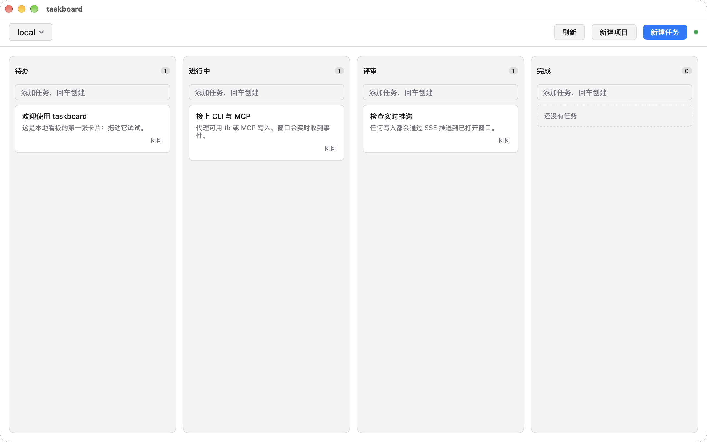
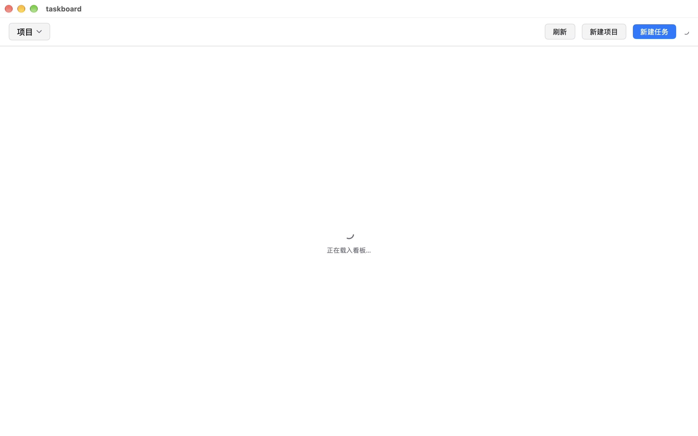
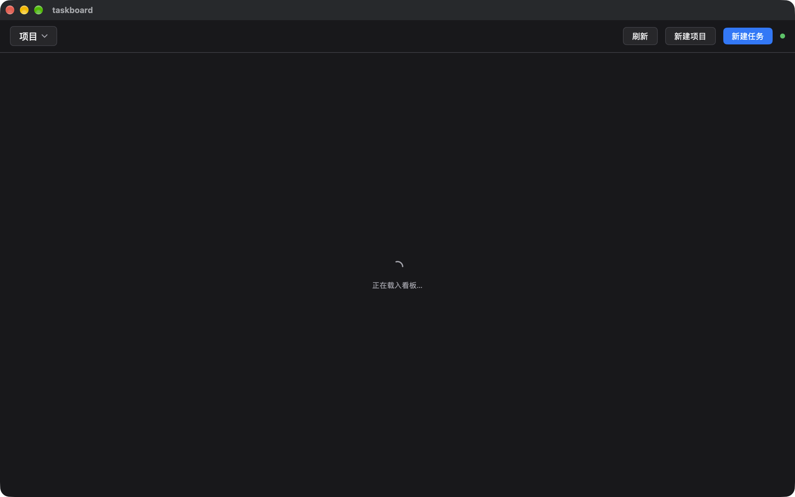
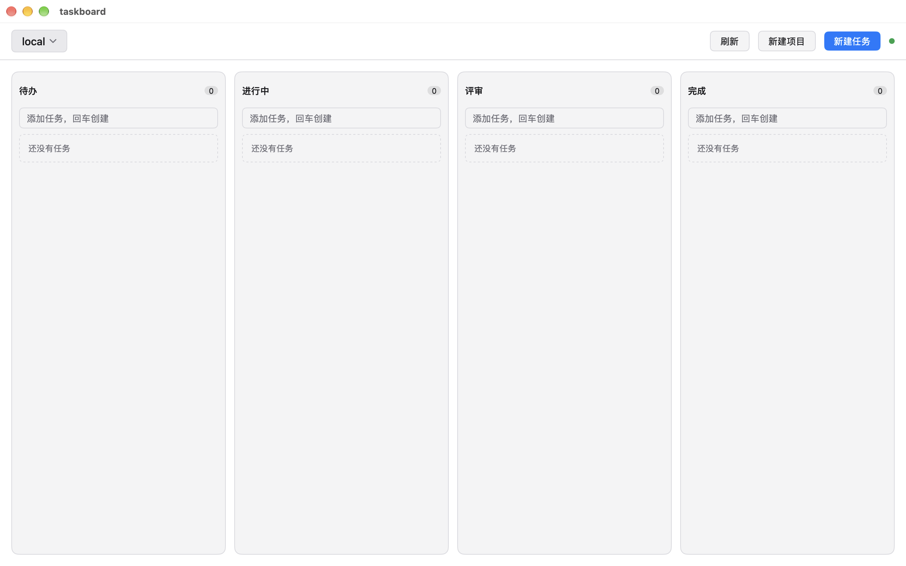
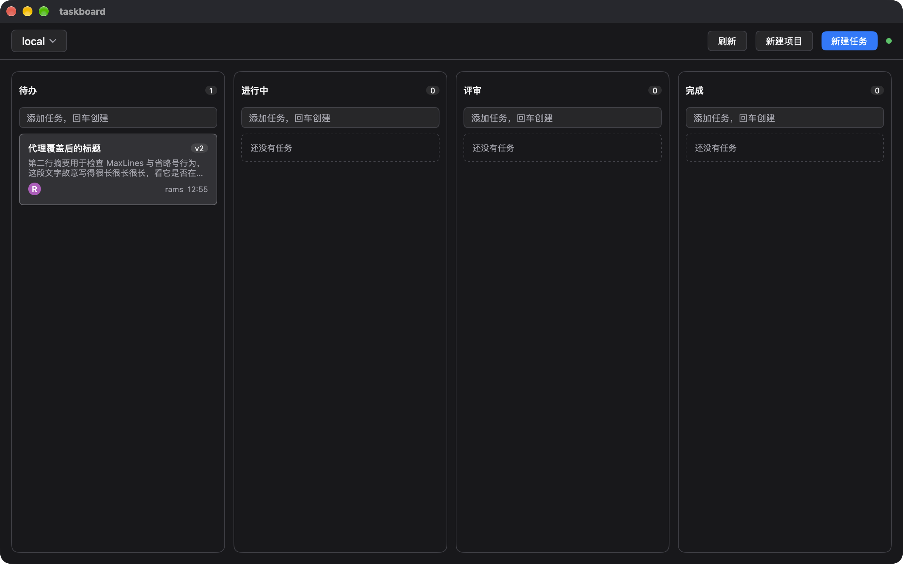
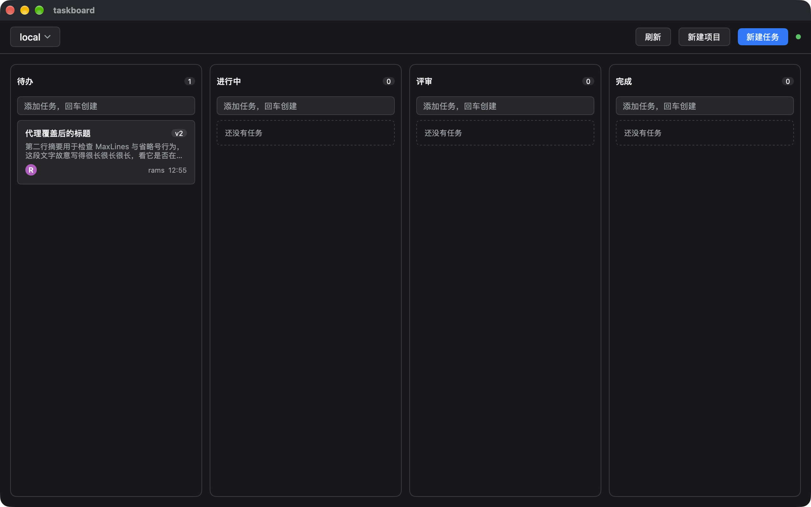
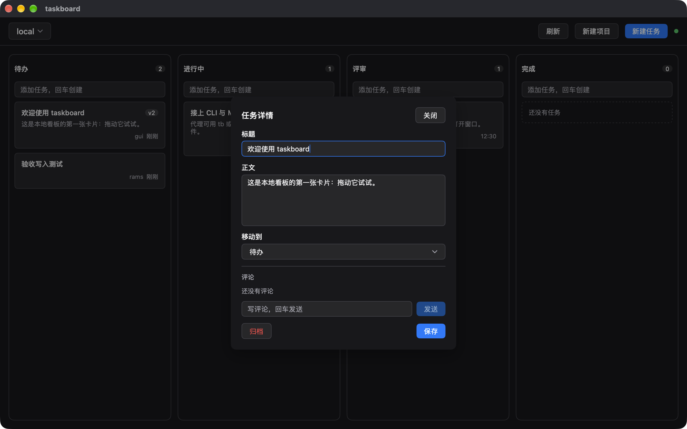
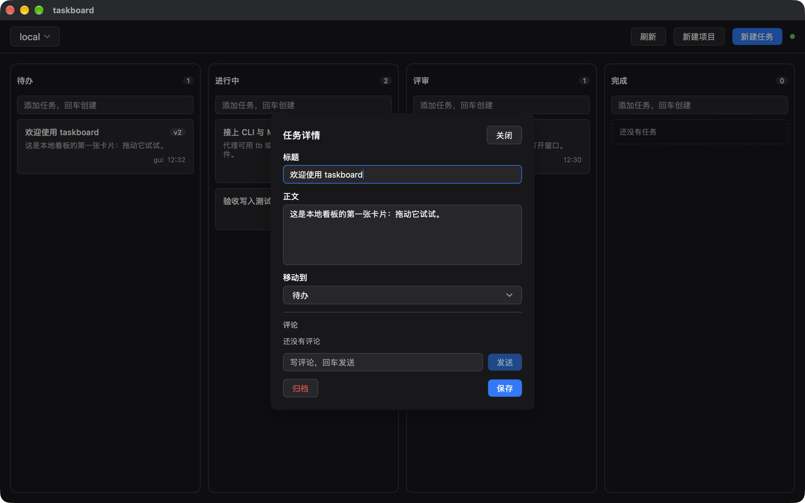
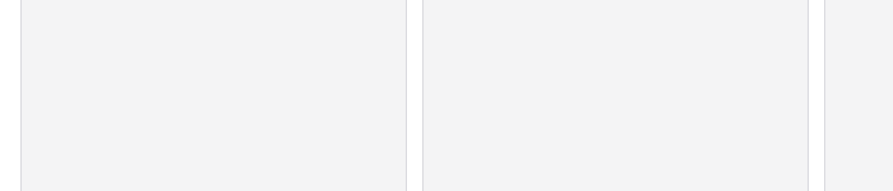

# 设计验收：MyGo 原生看板 v0（taskboard-native）

**日期**：2026-10-24（20:12–21:05 实跑）
**对象**：`cmd/taskboard` 真实窗口，1280×800，服务 `127.0.0.1:47827`，独立库 `/tmp/tb-review/taskboard.db`
**依据**：`docs/design.md`（§1–§12）、`docs/review-brief.md`、`skill://design-review`
**性质**：只读验收，未修改任何 `.go` 与 `docs/design.md`

## 复现（本报告的全部截图来源）

```bash
go build -o /tmp/tb-review/taskboard ./cmd/taskboard
rm -f /tmp/tb-review/taskboard.db
TASKBOARD_ADDR=127.0.0.1:47827 TASKBOARD_DB=/tmp/tb-review/taskboard.db \
  /tmp/tb-review/taskboard                  # 加载态：再加 TASKBOARD_SLOW=900ms / 1200ms / 1500ms
# 明暗：osascript -e 'tell application "System Events" to tell appearance preferences to set dark mode to {true,false}'
# 截图：Quartz CGWindowListCreateImage（screencapture 本机单帧约 50s，故改用此链路）
# SSE：TASKBOARD_ADDR=127.0.0.1:47827 go run ./cmd/tb add "验收写入测试" --project local --agent rams
#      TASKBOARD_ADDR=127.0.0.1:47827 go run ./cmd/tb move <id> 进行中 --agent rams
```

截图均为 2× Retina 像素（2560×1600 ↔ 1280×800 DIP），存于 `docs/assets/review/`。

## Overall Impression

静态画面是**干净、克制、有明确体系**的：四列等宽、间距节奏与 `t.Space` 刻度严丝合缝、字号刻度有真实层级、中文字体与英文数字混排对齐良好、暗色不再是上一版的"近白卡片+浅字"故障。问题集中在**状态层**：明色悬停把卡片填色塌进列底、弹层里未提交的编辑会被外部推送静默冲掉、加载态同时出现两个板级指示器。这些不是"不够漂亮"，而是会被用户当成坏掉/丢数据的缺陷。


## 证据总览

| 明色 | 暗色 |
| --- | --- |
|  |  |
|  |  |
|  |  |

加载态指示器与中文文案（明 / 暗）：


暗色卡片悬停（39,39,42 → 50,50,54，可读）与静止对照：




SSE 就地更新（CLI `add` / `move` 后窗口只重绘待办列、「进行中」列）：




## Findings

### High

**H1. 明色下卡片悬停后填色与列底完全相同，卡片看起来"漏成了洞"**
区域：看板列内卡片（任意列，静止 ↔ 悬停）。
证据：`docs/assets/review/window-light-card-rest.png`（静止）、`docs/assets/review/window-light-card-hover.png`（悬停）、局部裁切 `crop-light-rest-region.png` / `crop-light-hover-region.png`。



实测像素（同一坐标 300,470 处的卡片内部）：静止 `#ffffff` → 悬停 `#f4f4f5`；而列面板底色正是 `#f4f4f5`。即悬停瞬间卡片填充与列底对比度为 **1.00:1**，只剩描边变成 `#afafb3`（对比 1.99:1）。视觉结果是鼠标一进入卡片，卡片边界的那层"浮起感"消失，反而像列底被挖了一个矩形。
→ 修复：`cardHover(t)` 在明色下不能用 `t.Surface`（它与 `colFace(t)` 同值）。改走 `t.SurfaceHover`，并把悬停描边提到 `t.Border.Mix(t.Text, 0.35)` 左右；若要保持 §11"静止卡片无阴影"，最稳的是**明色卡片静止面改 `t.Surface`、悬停面改 `t.Background`**（与暗色方向互换），或给所有卡片一条比列底深一档的 1px 静止描边。注意 design.md §7 目前也把明色悬停写成 `t.Surface`，规格与实现同样需要改。

**H2. 弹层里已输入但未保存的标题，被外部代理的推送静默覆盖，随后"保存"还把弹层当成功关掉**
区域：任务详情弹层 → 标题/正文 → 收到他人更新（SSE）→ 点「保存」。
证据：`docs/assets/review/detail-title-edit-before-sse.png`（本地已键入，未保存）、`docs/assets/review/detail-title-edit-after-sse.png`（同坐标，外部 PATCH 到达后已被换成代理的标题）；整帧 `window-dark-detail.png` 为同一弹层的正常形态。


复现：打开卡片详情 → 在标题末尾键入文字 → `curl -X PATCH /api/tasks/{id} -H 'X-Agent: rams' -d '{"version":N,"title":"被代理抢先改的标题"}'` → 标题框内容直接被替换，无 toast、无冲突弹层。
成因（代码位置）：`cmd/taskboard/board.go:467 touchDetail()` 在 `b.saving == false` 时无条件覆写 `b.detail.title/body`，没有"本地是否已改"的判断；随后 `saveDetail()` 走 `title == cur.Title` 的早退分支（`board.go:536`）直接把弹层关掉——用户的输入既丢了、又拿到了"成功关闭"的假象，且 `updatedBy` 已变成 `rams`/`mcp`。这与 design.md §8"有未提交编辑 → 弹「任务已被修改」"的契约相反（§8 只描述了 409 路径，SSE 路径没被同一原则覆盖）。
→ 修复：`detail` 增 `dirty` 标记（与打开时快照比较），`touchDetail` 在 `dirty` 时只更新卡片和"最新版本号"，不动输入框，并给弹层一行提示"该任务已被 X 更新到 vN"；`saveDetail` 在 `dirty` 且版本已前进时按 409 同一套 `AlertDialog` 处理（`使用最新版本` / `保留我的修改`）。§8 需补一行：SSE 到达时若本地有未提交编辑，走同一冲突弹层。

（注：我尝试在真实窗口里再触发纯 409 弹层，两次都被 H2 抢先：外部更新先抹平了本地编辑，保存于是被判为"无改动"静默关闭，故**没有拿到 409 AlertDialog 的窗口截图**；`go test ./cmd/taskboard -run TestConflictAligns` 通过，说明该分支代码路径本身可用。）

### Medium

**M1. 初次载入时同时存在两个"板级"指示器，违反 §6 的"同一时刻最多一个"**
区域：顶栏最右 + 看板正中。
证据：`docs/assets/review/window-light-loading.png`、`docs/assets/review/window-dark-loading.png`、`crop-loading-label.png`。
实测：正中是 §6 第 1 行的 `Arc 20 / t.TextMuted / "正在载入看板"` + 文案"正在载入看板…"（符合）；**同时**顶栏最右还有一枚 12px 的 `Arc`（`view.go:131`，Label 正在连接本地服务）在转。§6 结尾明确"同一时刻最多一个全板级指示器（1、6）"，且"连接中"这一态在 §6 映射表里根本没有条目。
→ 修复：初次载入期间顶栏同步点画静止灰点（或干脆不画），把"连接中"补进 §6 作为行内态（尺寸/颜色/中文 Label 明确写死）；或者把板级 Arc 改为顶栏单点，二者选一。

**M2. 卡片上的"保存中"指示器尺寸 10，规格要求 14**
区域：卡片右下角时间戳位置。
证据：`cmd/taskboard/view.go:377`（`LinearDots Size: 10`）对照 §6 第 3 行（Size 14）；弹层内同一指示器 `view.go:504` 才是 14。
→ 修复：两处统一 14（`Size: 14`），并把尺寸写成一个常量，避免下次再分叉。

**M3. 暗色主按钮文字对比度 3.68:1，低于 WCAG AA 的 4.5:1**
区域：顶栏「新建任务」、弹层「保存」（暗色外观）。
证据：`docs/assets/review/window-dark-board.png` 顶栏右侧蓝钮。计算：`DarkTheme.Accent #3b82f6` 上的 `AccentText #ffffff` = **3.68:1**；明色同一位置 `#2563eb`/白 = **5.17:1**（通过）。按钮标签是 13px 正文尺寸，按 AA 需要 4.5:1。
→ 修复：这是 mygo `DarkTheme` 的取值，不改框架的前提下，在应用侧复制主题并覆盖 `Accent`（暗色用 `#2563eb` 一族，或把 `AccentText` 保持白色但把填充压到 `#1d4ed8`）；这类覆盖属于 §7 "由 Theme 字段表达"的合法范围。

**M4. 明色下虚线空态框与列描边几乎看不见（1.41:1 / 1.28:1）**
区域：空列占位「还没有任务」、所有列面板外框（明色）。
证据：`docs/assets/review/window-light-empty.png`。
计算：`Border #d9d9de` 对白卡 = **1.41:1**；对列底 `#f4f4f5` = **1.28:1**。非文本 UI 边界的最低建议是 3:1，实测列框在明色下要靠"知道那里有框"才看得出；暗色同类值为 1.7:1（`#3f3f46` 对 `#18181b`），也偏弱但比明色好。
→ 修复：明色列框/空态框改用 `t.Border.Mix(t.Text, 0.12)` 一档更深的描边（约 1.5 阶），空态虚线再深一档；这不引入新色值，仍是 Theme 派生。

**M5. 列容器缺少 `Role(RoleGroup)` + 列级 Label，计数 Label 挂在徽标上**
区域：每列（列头 + 计数）。
证据：`cmd/taskboard/view.go:217-236` —— 列 `ui.Column` 未设 `Role(ui.RoleGroup)`；`"待办列，3 个任务"` 这个串落在 `ui.Badge` 的 `.Label()` 上，而列容器本身对读屏只是一个无名字的容器。
这与 §3/§10"列容器 `Role(ui.RoleGroup).Label("待办列，3 个任务")`，让读屏进列时一次报出列名 + 计数"不符（当前要 Tab 到卡片组 `FocusGroup("待办列任务")` 才听到类似信息，且不含计数）。
→ 修复：给列面板加 `Role(ui.RoleGroup).Label(fmt.Sprintf("%s列，%d 个任务", col.Name, len(tasks)))`，徽标保留 `"N 条任务"` 之类的短 Label 以免重复朗读。

**M6. 详情弹层的"评论载入中"指示器不在 §6 映射表内**
区域：弹层「评论」标题右侧。
证据：`cmd/taskboard/view.go:456`（`BouncingDots Size 12 / t.TextMuted / "正在载入评论"`）。规格表只定义了 8 行，评论载入没有条目，因此尺寸/颜色/是否与"发送评论"同形（同为 BouncingDots）都无据可依；同一弹层内 BouncingDots 会先后承担"载入评论"和"发送评论"两种语义。
→ 修复：在 §6 增行（建议 `LinearDots 12 / t.TextMuted`），与"正在发送评论"（BouncingDots / Accent）区分开，避免同形不同义。

### Low

- **L1 顶栏多了一个 §1 未描述的「新建任务」主按钮**（`view.go:110`）。§1 的顶栏规格是"刷新 + 新建项目 + 同步点"，实际是"刷新 + 新建项目 + 新建任务(primary) + 同步点"，`新建项目` 与 `新建任务` 都开 Modal、文案仅一字之差，新用户第一眼容易点错。证据：`window-light-board.png` / `window-dark-board.png` 右上角。→ 文档补齐并考虑把任务创建收敛到列内输入框（该入口已存在且很好用）。
- **L2 空态占位框比卡片矮一截**：测得占位框高约 48 DIP（`empty` 帧 x=300 竖扫 361→457 像素 @2x），卡片 `MinHeight(64)`。同一列里"占位"与"卡片"不是同一节拍。证据：`window-light-empty.png`。→ 占位框设 `MinHeight(64)`，与卡片同高，空→有内容时不跳变。
- **L3 顶栏实测约 56 DIP，规格 52**：标题栏下沿到分隔线实测 168px@2x，减去系统标题栏约 28 DIP 后为 56 DIP（含 1 DIP 分隔线仍是 4 DIP 偏差；此项受标题栏实测误差影响，标为待复核）。规格写 `Height(52)`，实现也是 52，说明多出来的部分来自 Row 的内边距或分隔线基线。→ 复核后二选一：改实现或改文档。
- **L4 悬停描边提升有限**：明色 1.99:1、暗色 2.65:1（`Border.Mix(Text,0.22)` 计算值）。与 H1 叠加后，明色悬停的"唯一"可感知变化就是这条 1.99:1 的描边。→ 与 H1 一起调。

## 逐项规格核对（docs/design.md）

| 规格 | 判定 | 证据 / 说明 |
| --- | --- | --- |
| §1 窗口 1280×800、四列等分 303、列间距 s3、看板边距 s4 | **符合** | 实测列框边界 32/637、662/1292、1292/1922、1922/2527（@2x）→ 列宽 302.5 DIP、间隙 12.5 DIP、左右边距 16 DIP |
| §1 顶栏高 52 | **存疑（L3）** | 实测约 56 DIP，含分隔线 |
| §1 顶栏内容（刷新 / 新建项目 / 同步点） | **不符合（L1）** | 多出「新建任务」主按钮 |
| §2 间距只用 `t.Space`、字号只用 f-* 刻度 | **符合** | 通读 view.go/board.go：无裸像素间距；`fxs/fsm/fmd/flg` 四个函数覆盖全部字号 |
| §2 圆角（控件 6 / 面板与弹层 10 / 徽标 999） | **符合** | 目视与代码一致；列面板 `Radius+4`、卡片 `Radius` |
| §2 描边 1 DIP、悬停 `Mix(Text,0.22)` | **符合但效果偏弱（L4）** | 计算 1.99 / 2.65 |
| §2 背景分层由 `colFace/cardFace/cardHover` + `t.Dark` 分支 | **符合** | `view.go:26-45`，仅这三处分支 |
| §3 列头 32 高、`RoleHeading.Level(2)`、徽标计数 | **符合**（Role 见 M5） | 列头文字与徽标基线对齐 |
| §3 列容器 `Role(RoleGroup)` + 列级 Label | **不符合（M5）** | 仅 `FocusGroup` 有 Label |
| §3 列内输入框 Placeholder「添加任务，回车创建」+ Label | **符合** | `view.go:264` |
| §4 卡片 MinHeight 64、标题 `MaxLines(2)+Ellipsis`、摘要两行 | **符合** | `window-dark-card-truncation.png`：长摘要在第二行末截断并带省略号 |
| §4 版本徽标 / 评论计数 Label / 代理徽标 / 相对时间 | **符合** | 「v2」「rams/mcp」「刚刚」均在卡片右下 |
| §5 悬停变色 200ms、按下 `SurfacePressed` | **不符合（H1：明色）** | 暗色悬停 39,39,42 → 50,50,54（实测，见 `window-dark-card-hover.png`）；明色填充退化 |
| §5 键盘焦点环保留默认 | **未能验证** | 自动化按键后未取得可信焦点环截图，不下结论 |
| §6 行1 初次载入 `Arc 20 / TextMuted / 正在载入看板` + 文案 | **符合** | `window-light-loading.png` / `window-dark-loading.png` |
| §6 行2 切换项目 `Ring 16 / Accent` + 旧内容 `Opacity(0.55)` | **符合** | `view.go:100-102`、`boardArea` 的 `Opacity(0.55)`；窗口内未取到时序截图 |
| §6 行3 卡片保存 `LinearDots 14 / TextMuted / 正在保存任务` | **不符合（M2，卡片侧 10）** | 弹层侧 14 正确 |
| §6 行4 发评论 `BouncingDots 12 / Accent` + 输入框 Disabled | **符合** | `view.go:483-490` |
| §6 行5 同步点：静止 8×8 圆点 `Success`、事件后 `Pulse 10 / Accent` 1.2s | **基本符合** | `view.go:118-125`；实测 900ms 脉动（`flash()`）与规格 1.2s 有 300ms 差，属可接受偏差 |
| §6 行6 离线 `Comet 12 / Warning` + 文案 + 重试按钮 | **代码符合，窗口未取到** | `view.go:136-147`；窗口内起服务即进程自身，杀服务=杀窗口，无法在窗口内制造离线；`go test -run TestOfflineBanner` PASS |
| §6 行7 归档 `Arc 14 / TextMuted` | **符合** | `view.go:500` |
| §6 "最多一个全板级指示器" | **不符合（M1）** | 载入时中心 + 顶栏两个 |
| §6/§10 同屏两个指示器 Label 不同 | **不符合（隐患）** | 弹层保存时卡片页脚 `正在保存任务`（`view.go:377`）与弹层按钮左侧 `正在保存任务`（`view.go:504`）**同时**渲染，Label 重名，违反 §10 最后一条 |
| §7 暗色卡片不再近白、文字可读 | **符合（旧缺陷已修）** | 实测卡片面 `#27272a`（39,39,42），正文 `#f4f4f5` → 12.2:1；次要文字 `#a1a1aa` → 5.81:1，均过 AA |
| §7 暗色列面 = Background、卡片 = Surface | **符合**（视觉偏平，M4 同源） | 列面与窗底同为 24,24,27，卡片 39,39,42（1.19:1），仅靠 1.7:1 描边分层 |
| §7 明色列面 = Surface、卡片 = Background | **符合** | 244,244,245 / 255,255,255 |
| §7 危险色仅文字（归档） | **符合** | 弹层「归档」为红字无填充 |
| §7 主按钮 Accent + AccentText | **符合但对比度不足（M3）** | 暗色 3.68:1 |
| §8 整板无任务：每列虚线占位「还没有任务」 | **符合**（高度差异见 L2） | `window-light-empty.png` 四列各一块 |
| §8 无项目空态 | **未能验证** | 无删除项目入口，无法构造"零项目"；代码路径 `noProjectState` 存在 |
| §8 版本冲突 409 → AlertDialog | **未能验证（被 H2 抢先）** | 见 High 段说明；单测 PASS |
| §10 卡片 `RoleButton` + `Label("打开任务：…")` | **符合** | `view.go:317-320` |
| §10 按钮可读名（刷新看板/关闭详情/保存任务/归档任务/发送评论） | **符合** | 均显式 `.Label(...)` |
| §10 输入框一律有 Label | **符合** | 任务标题/任务正文/移动到列/写评论/项目名 |
| §11 无轮询、无全表重建、SSE 就地更新 | **符合** | 全仓无 ticker 拉任务（仅 SSE 心跳）；CLI 写入实测只重绘待办列区域（差异包围盒 x 54–1155 / y 243–703，其余列逐像素相同） |
| §11 无 `ui.Hex` / `ui.RGBA` 自造色 | **符合** | `grep` 无命中 |
| §11 静止卡片/列/按钮无阴影 | **符合** | 无 `Shadow` 调用（除框架 Modal） |

## What Looks Good

- **间距与字号是一套真体系**：列内 `Padding(s2.5)/Gap(s2)`、卡片 `Padding(s3)/Gap(s1.5)`、列头 32 高，肉眼能看到 4 的倍数在起作用；四列宽度实测 302.5/12.5 DIP 与 303/12 的规格误差在 1px 内。
- **暗色不再是"白卡+浅字"**：卡片面 `#27272a`、正文对比 12.2:1，上一轮的 High 缺陷确认修复；`TestAgentUpdateFlashesCard` 也已从超时变为 0.71s 通过。
- **层级靠明度而非花招**：没有渐变、没有阴影、没有装饰性大写标签，卡片标题 500 字重 + 摘要 muted 的两级信息密度正确，长摘要两行 + 省略号（`window-dark-card-truncation.png`）表现干净。
- **空态与文案到位**：四列各自"还没有任务"，中文全链路（占位、按钮、Label、Toast）没有英文漏字；相对时间「刚刚」与代理名并排时右对齐稳定。
- **SSE 就地更新是真的就地**：`tb add` 后窗口只重绘待办列（像素级验证），无闪烁、无整板重建；`tb move` 后卡片出现在「进行中」。这正是 §11 想要的效果。
- **弹层结构清晰**：字段标签在上、控件在下，`关闭` 在右上、`归档`（红字）在左、`保存`（主按钮）在右，阅读与操作动线符合习惯。

## Top 3 Fixes

1. **重做明暗两套的"静止 / 悬停"面关系**（H1 + L4 + M4）：明色悬停面不能等于列面（当前 1.00:1）。建议方向——明色：卡片 `t.Surface`、悬停 `t.Background`＋更深描边；暗色：保持现状但把列框提到 3:1。design.md §7 表格同步改。
2. **保护弹层里未提交的编辑**（H2）：`dirty` 判定 + SSE 到达时不覆写输入框 + 保存时走与 409 同一套冲突弹层；§8 增补 SSE 路径。
3. **收敛加载指示器**（M1 + M2 + M6 + 同屏 Label 重名）：一屏只留一个板级指示器；卡片/弹层保存统一 14；"载入评论"补进 §6 并换形；同屏保存时不重复渲染两枚同名指示器。

## 结论

**CONDITIONAL PASS（有条件通过）**

- 通过项：布局网格与间距体系、字号刻度、圆角描边一致性、暗色可读性（旧缺陷已修）、空态、SSE 就地更新无轮询、无障碍 Label 覆盖主体、无自造色/无 WebView 外壳。
- 条件项（必须修完再视为发布级）：**H1 明色悬停使卡片与列底融为一片**、**H2 未提交编辑被推送静默覆盖**；以及 M1/M2/M5/M3 四项规格偏差。
- 建议在修完后重跑：真实窗口明色悬停对比、弹层"边输入边被推送"场景、`TASKBOARD_SLOW=900ms` 首屏指示器计数。

## 未能覆盖的部分（如实记录）

- **离线横幅**：窗口进程内即服务进程，无法在窗口存活时切断 `/api/events`；只有 `TestOfflineBanner` 通过作为证据。
- **409 AlertDialog**：两次真实尝试均被 H2 的"静默覆盖 → 判定无改动 → 关闭"吃掉，未截到窗口图；仅单测 `TestConflictAligns` PASS。
- **无项目空态**：产品无删除项目入口，构造不出零项目。
- **键盘焦点环**：自动化按键（CGEvent）未能取得可判读的焦点环截图，未下结论。
- `screencapture -R/-l` 在本机单帧耗时约 50s（疑似触发了权限扫描），故全部窗口截图改用 Quartz `CGWindowListCreateImage` 抓取（同一窗口 ID `81912`/`81957`/`81966`/`81977`/`81986`，内容与 `screencapture` 一致）。
